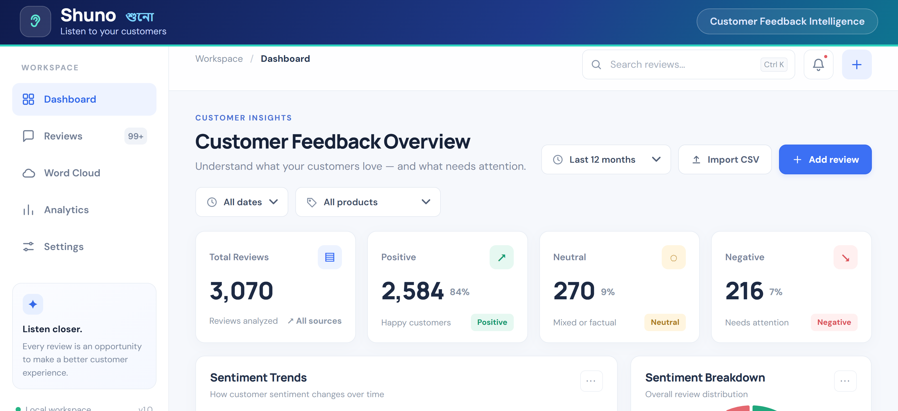
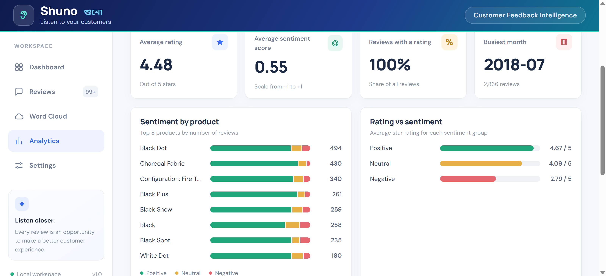
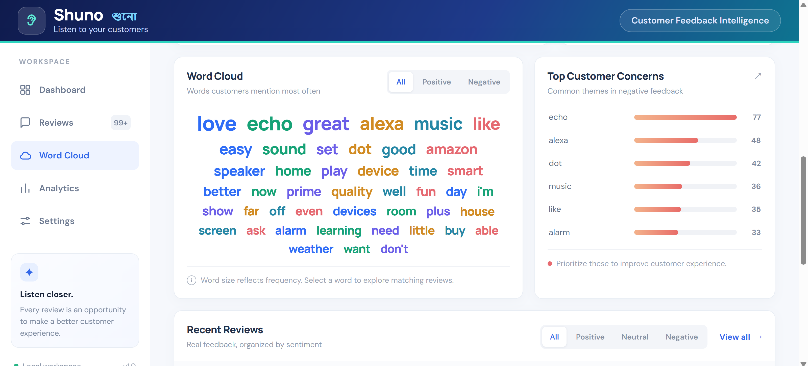
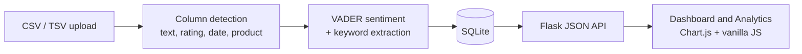

<div align="center">

  

  <br><br>

  <p>
    <b>A full-stack review analytics dashboard that turns thousands of customer reviews into clear answers.</b><br>
    Find out exactly <i>how customers feel</i>, <i>what they complain about</i>, and <i>what they praise</i>.
  </p>

  <p>
    
    
    
    
  </p>
  <p>
    <a href="https://github.com/NamTas/shuno-customer-feedback-intelligence/actions">
      
    </a>
    
  </p>

  <p>
    <a href="#what-it-does"><b>✨ Features</b></a> •
    <a href="#quick-start"><b>🚀 Quick Start</b></a> •
    <a href="#how-it-works"><b>⚙️ How it Works</b></a> •
    <a href="#roadmap"><b>🗺️ Roadmap</b></a>
  </p>

  <br>

  

</div>

## The problem

A business can receive thousands of reviews and still miss the one problem that keeps repeating, such as late delivery or poor packaging. Nobody has time to read every review.

**Shuno reads them for you.** Upload a CSV, and it shows the overall mood, the trend over time, the top complaints and the top praise, filtered by date and product.

## What it does

| | |
|---|---|
| **Dashboard** | Total reviews, sentiment split, monthly sentiment trend, sentiment breakdown, top customer concerns, interactive word cloud, searchable review feed with details |
| **Analytics** | Average rating and sentiment score, sentiment by product, rating vs sentiment, review volume per month, top positive and negative words |
| **Filters** | **All dates** and **All products** change every number, chart and list at once |
| **Import** | CSV and TSV files; columns for text, rating, date, product and author are detected automatically |
| **Add a review** | Type a review in the app and it is analyzed instantly |

<table>
  <tr>
    <td></td>
    <td></td>
  </tr>
</table>

## How it works



## Engineering decisions

- **Clear separation of concerns.** `services.py` holds four small classes (`SentimentAnalyzer`, `KeywordExtractor`, `ReviewRepository`, `ReviewService`). `app.py` contains only routes, so the logic can be tested without a web server.
- **Real-world CSV handling.** The importer finds columns by name, reads both comma- and tab-separated files, and understands several date formats and Unix timestamps. When several columns look like review text, it picks the one with the longest text, so a short 0/1 `feedback` flag is never mistaken for the review.
- **Safe SQL.** All queries use bound parameters. Filters (year, product, sentiment, search) are combined in one place, `ReviewRepository._where`.
- **Database upgrades.** Older databases get the new `product` column automatically, so existing data is not lost.
- **Large files.** `make_sample.py` cuts a huge dataset down using reservoir sampling, which needs very little memory, and can keep only the most-reviewed products so product charts have enough data.
- **Friendly errors.** Bad input, a missing review column or a file over 25 MB returns a clear message instead of a crash.
- **Works offline.** Chart.js and Bootstrap are bundled in `static/vendor`; only the Google Fonts need internet, and system fonts are used as a fallback.
- **Tested.** 13 pytest tests cover sentiment labels, keyword extraction, CSV/TSV import, column detection, filters, analytics, database upgrade and the HTTP API. They run automatically on every push with GitHub Actions.

## Tech stack

| Layer | Tools |
|---|---|
| Backend | Python, Flask |
| Data | SQLite, SQL |
| NLP | VADER sentiment, frequency-based keyword extraction |
| Frontend | HTML, CSS, vanilla JavaScript, Bootstrap 5, Chart.js |
| Quality | pytest, GitHub Actions |

## Quick start

**Windows (PowerShell)**
```powershell
py -m venv .venv
.\.venv\Scripts\Activate.ps1
python -m pip install -r requirements.txt
python app.py
```

**macOS / Linux**
```bash
python3 -m venv .venv
source .venv/bin/activate
pip install -r requirements.txt
python app.py
```

Open <http://127.0.0.1:5000>. On the first run the app loads a small **synthetic** demo dataset (`sample_reviews.csv`) so the dashboard is not empty. To start fresh, open **Settings → Delete all reviews**.

Run the tests with `python -m pytest`.

## Use your own data

1. Click **Import CSV** (or **Import** in the sidebar) and choose a file.
2. Shuno looks for these columns by name:

| Data | Column names it recognizes | Required |
|---|---|---|
| Review text | `text`, `review`, `comment`, `feedback`, `content` | Yes |
| Rating | `rating`, `star`, `score` | No |
| Date | `date`, `time` (dates or Unix timestamps) | No, needed for trends |
| Product | `product`, `category`, `department`, `class`, `variation` | No |
| Author | `author`, `reviewer`, `profile`, `user` | No |

For very large files, make a sample first:
```bash
python make_sample.py Reviews.csv reviews_5000.csv 5000 12
```
This keeps 5,000 random reviews from the 12 most-reviewed products.

## Demo with real data

<!--
Fill this section in after you test with a real dataset. Use only numbers you saw in your own dashboard.

Dataset: [name](link to the Kaggle page), license: ...
Reviews analyzed: ...
Sentiment split: ...% positive, ...% neutral, ...% negative
Top complaints: ..., ..., ...
One finding: ...
-->

## Limitations

- Sentiment uses **VADER**, a rule-based model built for English. It can miss sarcasm and does not understand Bangla.
- "Concerns" are the most frequent words in negative reviews. This is a simple frequency count, not topic modeling.
- It is a single-user local app with no login. The demo data is synthetic.

## Roadmap

- [ ] Bangla sentiment support with a transformer model
- [ ] Topic grouping of complaints (TF-IDF or LDA)
- [ ] Export a summary report as PDF or CSV
- [ ] Docker image and a public deployment
- [ ] Optional user accounts

## Project structure

```
shuno/
├── app.py              # Flask routes and app factory
├── services.py         # Sentiment, keywords, SQLite repository, CSV import, analytics
├── make_sample.py      # Cut a big dataset down to a useful sample
├── sample_reviews.csv  # Synthetic demo data
├── templates/index.html
├── static/             # app.js, style.css, vendor/ (Chart.js, Bootstrap)
└── tests/test_services.py
```

## About the author

Built by **Namira**, Computer Science and Engineering graduate (AUST, Dhaka), as part of my entry-level data and software engineering portfolio.

[LinkedIn](https://www.linkedin.com/in/namtas) · [GitHub](https://github.com/NamTas)

## Credits and license

Released under the [MIT License](LICENSE). Uses [VADER Sentiment](https://github.com/cjhutto/vaderSentiment), [Chart.js](https://www.chartjs.org/) and [Bootstrap](https://getbootstrap.com/), all open source. If you use a public dataset, credit its source and respect its license.
